# Mume Music Player — 项目结构与架构说明

> 一个按 Pixso 设计稿 `Mume - Music Player App UI Kit` 复刻的 Flutter 音乐播放器。
> 设计稿共 4 个页面分类（🔆 Light Theme / 🌙 Dark Theme / 🎨 Design System / 👀 Preview），
> 其中 Light 与 Dark 各含 **41 个界面**，本项目全部实现。

---

## 1. 项目概览

| 项 | 值 |
| --- | --- |
| 应用名 | Mume Music Player |
| 包名 | `com.mume.mume_music_player` |
| 框架 | Flutter 3.47.7 stable / Dart 3.13.5 |
| 状态管理 | `provider` 6.1（`ChangeNotifier`） |
| UI 规范 | Material 3 + 自定义 `ThemeExtension` |
| 字体 | Urbanist（随包 4 个字重） |
| 平台 | Android / iOS |
| 代码量 | `lib/` 46 个 Dart 文件，约 9.5k 行；`test/` 3 个测试文件 |
| 音频 | **模拟播放**（设计稿为纯 UI Kit，未提供音源） |

界面覆盖：启动页、引导页、首页 5 个分类（Suggested / Songs / Artists / Albums / Folders）、
播放器与歌词、艺人 / 专辑 / 文件夹详情、最近播放、搜索、收藏、歌单（新建 / 编辑 / 详情 / 加歌）、
设置（通知 / 语言 / 分享 / FAQ / 退出确认）、Premium 订阅全流程（套餐 → 支付方式 → 加卡 → 订单确认 → 成功）。

---

## 2. 目录结构

```
MumeMusicPlayer/
├── lib/
│   ├── main.dart                     # 入口：MultiProvider + MaterialApp + 主题切换
│   │
│   ├── app/                          # 【共享套件层】与业务无关，所有界面复用
│   │   ├── router.dart               # 路由常量表 + onGenerateRoute 工厂
│   │   ├── theme/
│   │   │   ├── app_colors.dart       # 设计稿取色：主色/中性色/渐变对
│   │   │   ├── app_typography.dart   # Urbanist 字号阶梯 + heading()/body() 工厂
│   │   │   ├── app_dimens.dart       # 间距、圆角、封面尺寸常量
│   │   │   └── app_theme.dart        # AppInk(ThemeExtension) + light()/dark()
│   │   └── widgets/
│   │       ├── app_shell.dart        # MumeScaffold / 底部导航 / 迷你播放器
│   │       ├── page.dart             # PageTopBar / MumePage / 主题切换按钮
│   │       ├── buttons.dart          # 主按钮、软按钮、图标按钮、播放徽标、下划线 Tab
│   │       ├── tiles.dart            # 歌曲/歌单/艺人/专辑/设置/选项 行组件
│   │       ├── sheets.dart           # 底部抽屉容器 + 确认弹窗
│   │       ├── song_option_sheet.dart# 长按歌曲的 10 项操作面板
│   │       ├── detail_sections.dart  # 详情页共用的歌曲列表与操作面板
│   │       ├── sort_menu.dart        # 右上角锚定排序菜单
│   │       └── app_logo.dart         # Logo / 字标 / CoverArt 封面组件
│   │
│   ├── data/                         # 【数据与状态层】纯 Dart，不依赖 Flutter Widget
│   │   ├── models/media.dart         # Song / Album / Artist / Playlist / Folder
│   │   ├── music_library.dart        # 32 首歌 + 6 艺人 + 8 专辑 + 5 文件夹 种子数据与检索
│   │   ├── library_store.dart        # 收藏 / 最近播放 / 歌单 / 搜索历史 / 设置项
│   │   └── player_controller.dart    # 播放队列、进度、歌词行、循环/随机/倍速/睡眠
│   │
│   └── features/                     # 【界面层】按业务域分包，一屏一文件
│       ├── onboarding/               # splash / walkthrough
│       ├── home/                     # 首页 5 个 Tab + 最近播放
│       ├── shell/                    # RootShell：四个根 Tab 的宿主
│       ├── player/                   # 播放页 + 歌词页
│       ├── search/                   # 搜索（输入 / 无结果 / 结果列表）
│       ├── artist/  album/  folders/ # 三类详情
│       ├── favorites/                # 收藏
│       ├── playlist/                 # 歌单列表 / 新建 / 详情 / 加歌
│       ├── settings/                 # 设置 / 通知 / 语言 / 分享 / FAQ
│       └── premium/                  # 订阅 5 步流程
│
├── assets/
│   ├── fonts/Urbanist-{Regular,Medium,SemiBold,Bold}.ttf
│   └── images/
│       ├── logo_mark.png  premium_banner.png  walkthrough_{1,2,3}.png
│       └── covers/                     # 23 张真实专辑封面（从设计稿导出）
│
├── docs/
│   ├── ARCHITECTURE.md                 # 本文件
│   └── screenshots/
│       ├── light/  01_splash.png … 41_quit_modal.png   # 设计稿 Light 41 屏
│       ├── dark/   01_splash.png … 41_quit_modal.png   # 设计稿 Dark 41 屏
│       └── app/                                        # 模拟器实机截图
│
├── test/                               # 数据层单测 + Widget 冒烟测试
├── android/  ios/
└── pubspec.yaml
```

---

## 3. 架构分层与依赖方向

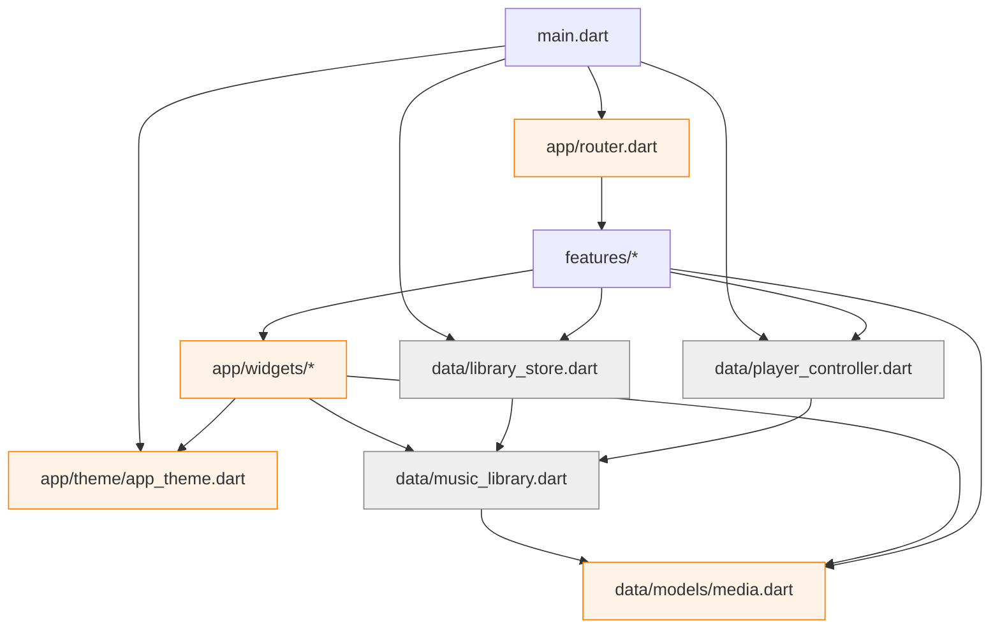

依赖以 **自上而下** 为主：`features → app/widgets → app/theme / data`。
`data/` 不 import 任何 Widget；除 `router.dart` 负责组装页面外，`app/` 不反向依赖 `features/`。
因此新增界面时，页面与共享组件保持解耦，只需在 `router.dart` 注册对应路由。

---

## 4. 设计令牌（Design Tokens）

设计稿的 🎨 Design System 页没有可用的 Pixso 变量（`get_variables` 返回空），
色值与字号是从 41 个 Frame 的 TEXT 节点上直接读取的，集中在三个文件里：

### 4.1 颜色 `app_colors.dart`

| 令牌 | 值 | 用途 |
| --- | --- | --- |
| `primary` | `#FF8216` | 主色：播放键、选中态、进度条 |
| `secondary` | `#FFD300` | 强调黄 |
| `white / black` | `#FFFFFF / #000000` | |
| `grey900 → grey200` | `#212121 → #EEEEEE` | 浅色主题的正文 / 次要文字 / 分隔线 / 浅底（共 11 档） |
| `dark1 / dark2 / dark3` | `#181A20 / #1F222A / #35383F` | 深色主题的页面底 / 卡片底 / 描边 |
| `bgOrange`（及 Yellow/Green/Purple/Blue/Pink） | `#FFF5ED …` | 六组浅色容器底 |
| `success / info / warning / error` | `#0ABE75 / #246BFD / #FACC15 / #F75555` | 状态色 |
| `gradientOrange` | `#FFB347 → #FF7A00` | 主按钮、Logo 徽章、Premium 横幅 |
| `gradient{Yellow,Green,Purple,Blue,Red}` | 共 6 组 | 订阅套餐卡、分类标签 |

### 4.2 排版 `app_typography.dart`

字体族固定为 `Urbanist`，两级工厂函数覆盖全部用法：

```dart
AppTypography.heading(AppTypography.h4)          // w700, height 1.2  —— 页面大标题
AppTypography.body(AppTypography.bodyLarge,       // w400(可覆盖), height 1.35 —— 正文/副标题
    weight: FontWeight.w700)
```

字号阶梯：`h1 48 · h2 40 · h3 32 · h4 24 · h5 20 · h6 18` 与
`bodyXLarge 18 · bodyLarge 16 · bodyMedium 14 · bodySmall 12 · bodyXSmall 10`。

### 4.3 间距与圆角 `app_dimens.dart`

`Insets.page = 24`（页面左右安全边距）、`gapXs 4 → gap2xl 32`、
`radiusSm 8 → radiusXl 24 / radiusPill 999`、
封面三档 `coverTile 56 · coverGrid 110 · coverHero 380`、`navBarHeight 72`。
数值直接来自 428pt 宽画板的测量结果。

### 4.4 语义色：`AppInk extends ThemeExtension`

深浅两套主题不是各写一遍样式，而是同一套语义角色换值：

| 角色 | Light | Dark |
| --- | --- | --- |
| `page` 页面底 | `#FFFFFF` | `dark1` |
| `card` 卡片底 | `#FFFFFF` | `dark2` |
| `tint` 高亮容器 | `bgOrange` | `dark2` |
| `ink` 主文字 | `grey900` | `#FFFFFF` |
| `inkMuted / inkSoft` 次要文字 | `grey600 / grey500` | `grey400 / grey600` |
| `divider` 分隔线 | `grey200` | `dark3` |

界面通过 `BuildContext` 扩展读取语义色；品牌橙等固定令牌则直接使用 `AppColors`：

```dart
Color get inkPrimary => ink.ink;      // context.inkPrimary
Color get cardBackground => ink.card; // context.cardBackground
Color get separatorColor => ink.divider;
```

切换入口有两处：设置页的 Dark Mode 开关、以及每个详情页右上角的圆形按钮，
都写回 `LibraryStore.darkMode`；`main.dart` 用 `Consumer<LibraryStore>` 把它映射成
`ThemeMode.dark / light`，因此全局即时重绘。

---

## 5. 数据层

### 5.1 模型 `models/media.dart`

```
Song    { id, title, artist, album, duration, cover, trackNumber, releaseYear }
Album   { id, title, artist, cover, songIds, year }
Artist  { id, name, cover, songIds, albumIds }
Playlist{ id, name, cover, songIds, createdOrder }   // 可变，支持增删改
Folder  { id, name, path, songIds, subfolderCount }
```

关系全部用 **id 引用**（`songIds` / `albumIds`），避免对象互相持有造成循环；
顶层 `formatClock(Duration)` 统一 `mm:ss`（超一小时走 `h:mm:ss`）。

### 5.2 种子数据 `music_library.dart`

`MusicLibrary` 是一个纯静态类，充当"本地曲库"：

- 32 首歌（Starboy、Shades of Love、Out of Time、Sweater Weather…），6 位艺人，8 张专辑，
  6 个初始歌单，5 个文件夹；
- 检索：`songById / songsByIds / artistById / albumById / albumsOf / folderById`；
- 反查：`albumOfSong(song)` / `artistOfSong(song)` —— 单曲没有所属专辑时**合成**一个
  单曲专辑对象，保证"Go to Album / Go to Artist"永远可点；
- 榜单：`recentlyPlayed / mostPlayed / suggested`；
- `lyricsFor(song)` 返回该曲的歌词行数组（Starboy 等使用设计稿里的真实歌词，其余回落到通用文案）；
- `cover(int)` 在 23 张真实封面间轮转，保证同一首歌每次拿到同一张图。

### 5.3 两个 ChangeNotifier

| | `LibraryStore` | `PlayerController` |
| --- | --- | --- |
| 职责 | 曲库的"用户侧状态" | 播放会话 |
| 关键字段 | `favorites`、`recentlyPlayed`、`recentSearches`、`playlists`、`songSort`、`darkMode`、通知开关、`language` | `queue`、`index`、`position`、`isPlaying`、`shuffle`、`repeat`、`speed`、`sleepMinutes`、`lyricLine` |
| 关键方法 | `toggleFavorite`、`markPlayed`、`pushSearch`、`createPlaylist`、`addToPlaylist`、`deletePlaylist`、`sortedSongs`、`search` | `playQueue`、`toggle`、`seek`、`skip`、`next`、`previous`、`jumpTo`、`playNext`、`toggleShuffle`、`cycleRepeat`、`cycleSpeed` |
| 谁监听 | `main.dart`（主题）、各列表页 | `MiniPlayer`、播放页、歌词页 |

两者在 `main.dart` 顶层用 `MultiProvider` 注册，页面里 `context.watch` 读、`context.read` 写。
歌单/收藏的增删只改内存对象并 `notifyListeners()`——**没有引入持久化依赖**，
这是刻意的：设计稿只定义视觉，落库方案（如 `shared_preferences` / `drift`）留给后续迭代。

### 5.4 模拟播放

`PlayerController` 用一条 `Timer.periodic(250ms)` 推进 `position`（乘以 `speed` 实现倍速），
到曲尾按 `RepeatMode` 决定停止 / 切下一首 / 单曲循环；
歌词行号由 `position / duration` 在 `lyricsFor()` 的行数组上取整得到。
好处是无需真实音频即可完整演示进度条、迷你播放器进度、歌词滚动与倍速；
代价是**没有声音**。接真实音源时只需把 `position` 的来源换成 `AudioPlayer.positionStream`，
其余 UI 不用动。

---

## 6. 路由

`router.dart` 用一张字符串常量表 + `onGenerateRoute` 的 `switch` 表达式承载全部导航，
没有引入 `go_router` 等外部依赖：

| 路由 | 屏幕 | 设计稿 |
| --- | --- | --- |
| `/` | SplashScreen | 01 |
| `/walkthrough` | WalkthroughScreen | 02–04 |
| `/home` | RootShell(home) | 05–06, 11–12, 15, 17 |
| `/favorites` | RootShell(favorites) | 23–24 |
| `/playlists` | RootShell(playlists) | 25, 28 |
| `/settings` | RootShell(settings) | 30, 41 |
| `/search` | SearchScreen | 20–22 |
| `/player` · `/player/lyrics` | PlayerScreen · LyricsScreen | 09–10 |
| `/recently-played` | RecentlyPlayedScreen | 19 |
| `/artist` · `/album` · `/folder` | 三类详情，参数 `MediaArgs(id)` | 14, 16, 18 |
| `/playlist` · `/playlists/new` | 歌单详情 / 新建或重命名 | 27, 26 |
| `/playlists/pick` · `/playlists/songs` | 加入歌单 / 向歌单添加歌曲 | 29, 27 的加歌流程 |
| `/settings/notification` · `language` · `share` · `faq` | 设置子页 | 37–40 |
| `/premium` → `payment` → `payment/card` → `review` → `success` | 订阅五步 | 31–36 |

一个容易做错的点：设计稿里"收藏 / 歌单 / 设置"三屏**同时**画了返回箭头和底部导航。
解法是 `RootShell` 作为底部导航的唯一宿主，三个根路由各自 `push` 一个新的
`RootShell(initialTab: …)`，于是既保留了底部导航，又自然出现了可返回的栈。

---

## 7. 共享套件层（`app/widgets`）

这是"设计系统落地"的地方，也是让 41 屏代码量可控的关键——
每个界面文件平均 200 行，因为它们只描述**内容**，不描述**外观**。

| 文件 | 提供 | 对应设计稿 |
| --- | --- | --- |
| `app_shell.dart` | `MumeScaffold`（Stack 叠迷你播放器 + 底部导航）、`MumeBottomNav`、`MiniPlayer` | 05, 11, 23, 25, 30 |
| `page.dart` | `PageTopBar`（实现 `PreferredSizeWidget`）、`MumePage`（顶栏 + 可滚动主体 + 吸底按钮）、`PageHeaderActions` | 全部详情页 |
| `buttons.dart` | `PrimaryPillButton`（橙色渐变 + 发光阴影）、`SoftPillButton`、`OutlinedIconButton`、`GhostIconButton`、`PlayBadge`、`UnderlineTabs` | 02–06, 09 |
| `tiles.dart` | `SectionHeader`、`CountSortBar`、`SongTile`、`PlaylistTile`、`ArtistCell`、`AlbumCell`、`OptionTile`、`SettingTile`、`EmptyState` | 06, 12–18, 22, 30 |
| `sheets.dart` | `MumeSheet`（带拖拽条的底部抽屉）、`SongSheetHeader`、`showMumeSheet`、`confirmDialog` | 08, 13, 24, 41 |
| `song_option_sheet.dart` | 长按歌曲的 10 项操作面板 + 歌曲详情弹窗 | 08 |
| `detail_sections.dart` | 艺人 / 专辑 / 文件夹 / 歌单共用的详情区与媒体操作 | 13–18, 27 |
| `sort_menu.dart` | 右上锚定的单选排序菜单，含分隔线与选中图标 | 07 |
| `app_logo.dart` | `AppLogo`（含徽章态）、`AppWordmark`、`CoverArt` | 01, 05 |

---

## 8. 主要界面

### 8.1 启动与引导

| | | |
| --- | --- | --- |
|  |  |  |
| 01 启动页：Logo 徽章 + 旋转点阵加载 | 02 引导页第 1 步 | 04 引导页第 3 步（Get Started） |

### 8.2 首页五个分类

首页是 `AppWordmark + UnderlineTabs + TabBarView`，五个 Tab 分别是横向封面轨、
歌曲列表、艺人网格、专辑双列瀑布、文件夹列表。

| | | | | |
| --- | --- | --- | --- | --- |
| 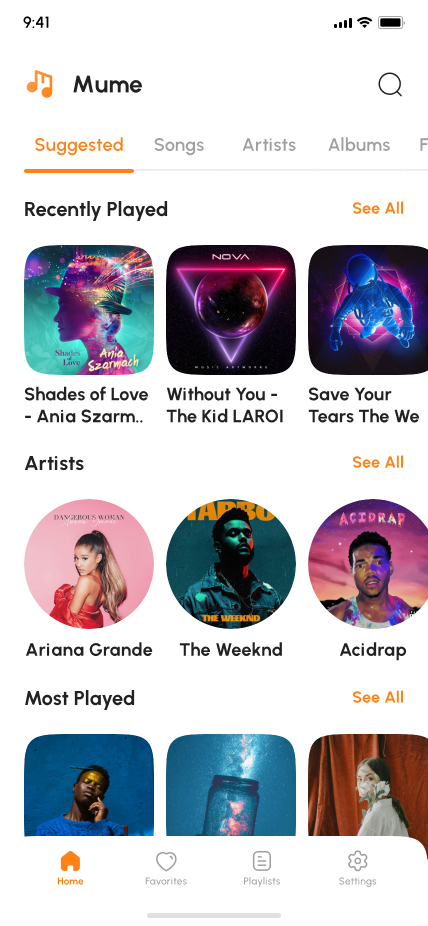 | 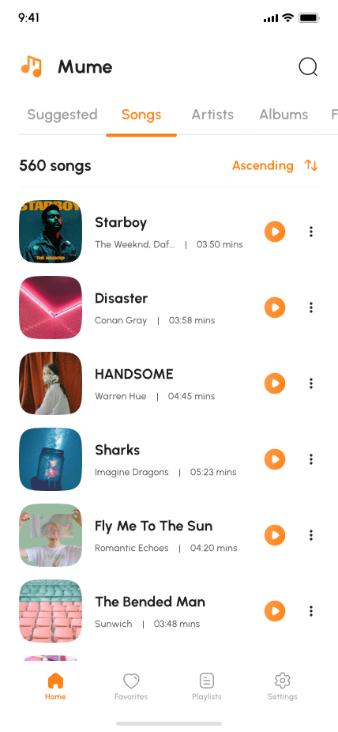 | 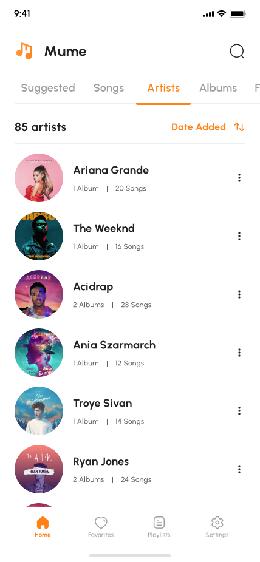 | 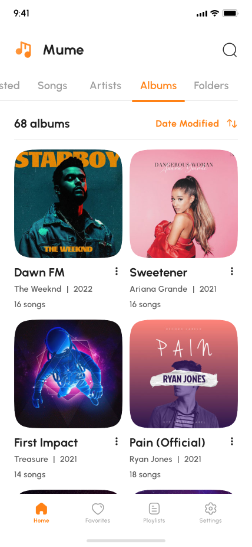 | 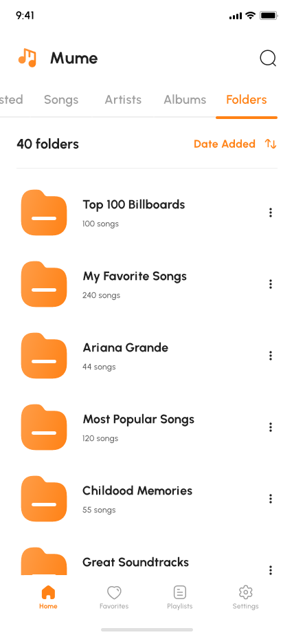 |
| 05 Suggested | 06 Songs | 12 Artists | 15 Albums | 17 Folders |

### 8.3 播放器与歌词

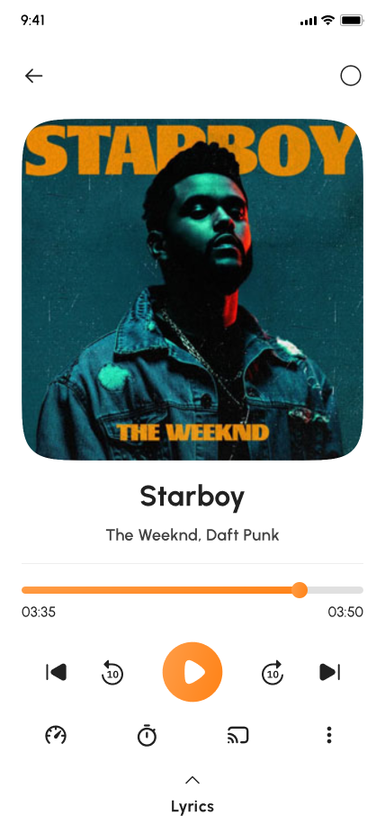
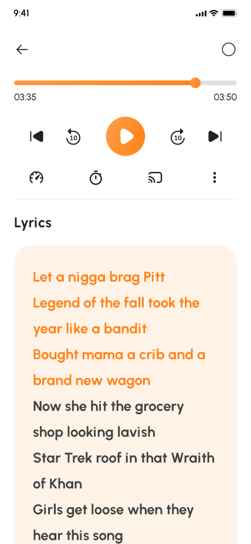

播放页：`Hero` 共享封面（380pt）、进度条、五个传输按钮（上一首 / 后退 10s / 播放 / 前进 10s / 下一首）、
下排四个次级控制（倍速 / 睡眠定时 / 投屏 / 更多），底部是歌词预览卡；
点击预览卡进入歌词页，不重复绘制大封面，保留进度与传输控制；当前行及此前歌词高亮为橙色。
设计稿 11 则是 Home Songs 列表叠加迷你播放器，不是另一个播放详情页。

### 8.4 操作面板与排序

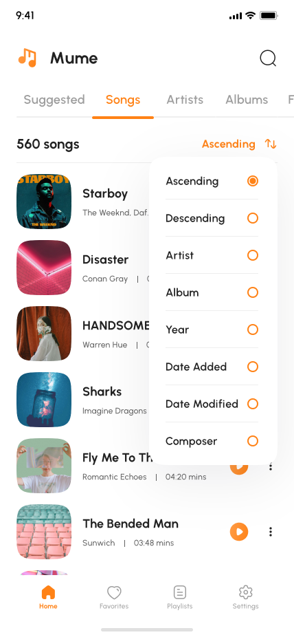
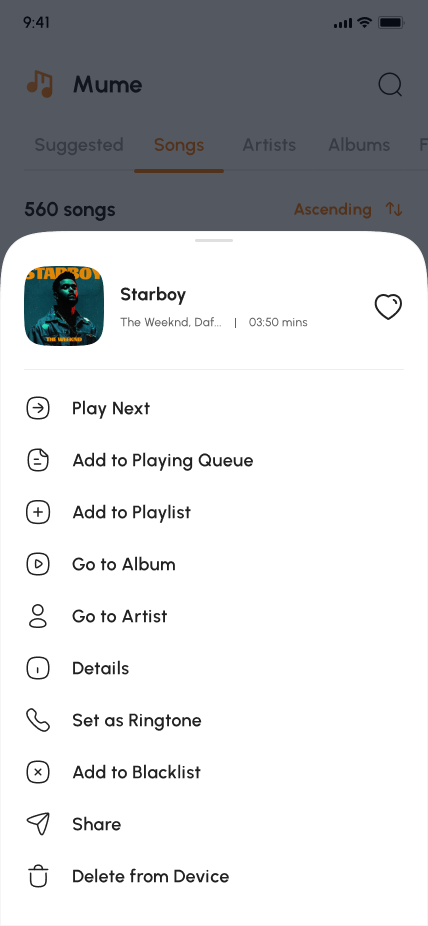

排序使用右上角锚定菜单；歌曲、艺人、专辑和文件夹操作复用底部面板，其中媒体操作支持
Play、Play Next、加入队列、批量加入歌单和分享。

### 8.5 搜索

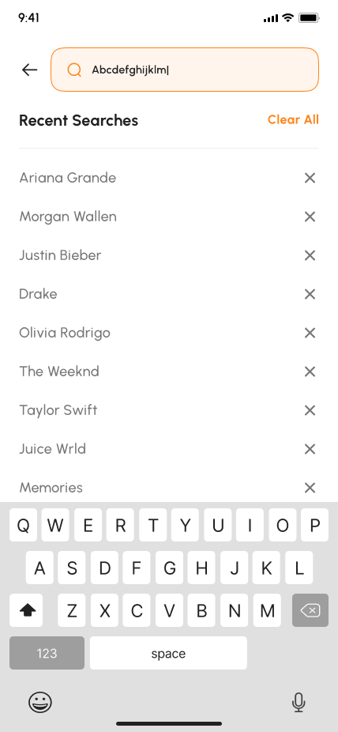
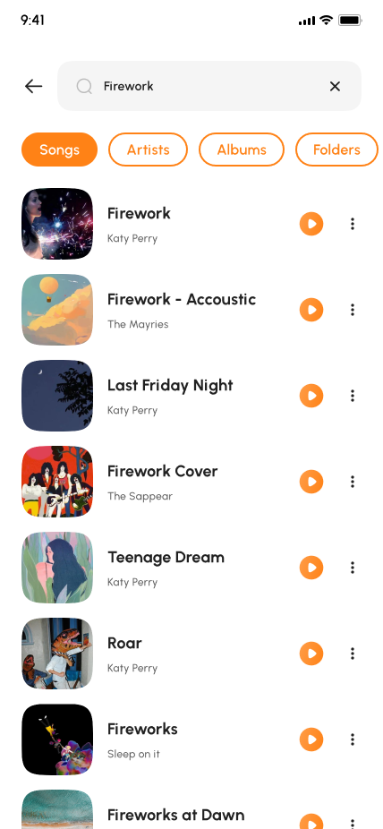

搜索页有三种状态：历史/热搜（20）、无结果空态（21）、结果列表按歌曲/艺人/专辑分组（22）。

### 8.6 歌单与设置

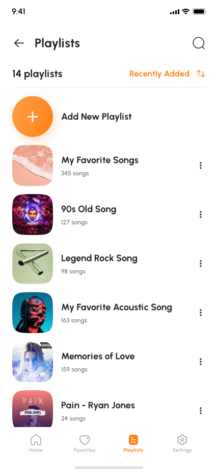
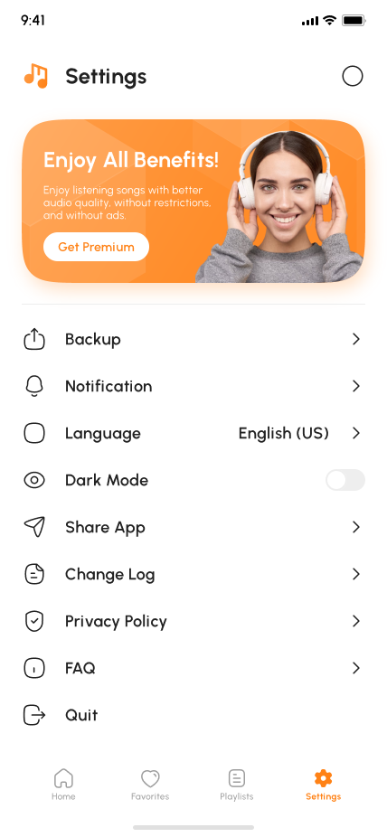

歌单详情支持 Date Added 排序、右侧方形加歌按钮，以及顶栏圆钮中的
Edit Playlist Info / Delete Playlist 锚定菜单；新建与编辑共用表单。

### 8.7 Premium 订阅流


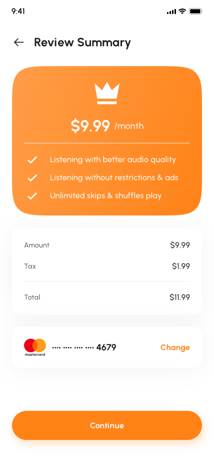

### 8.8 深色主题

Light / Dark 两套主题共用同一份代码，仅 `AppInk` 换值：

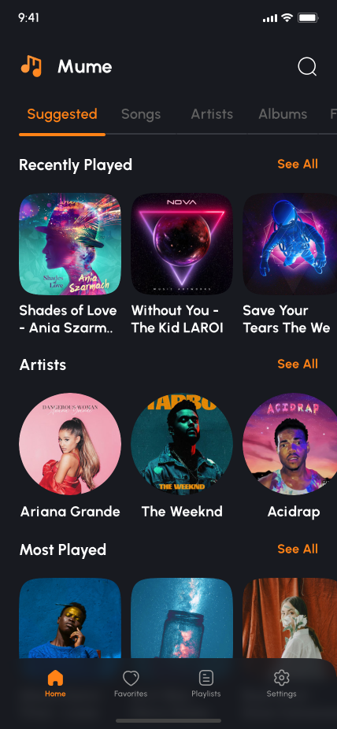
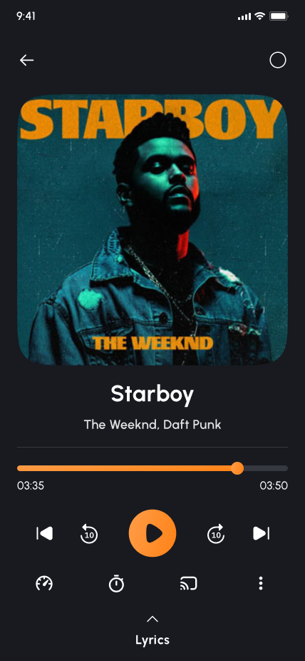
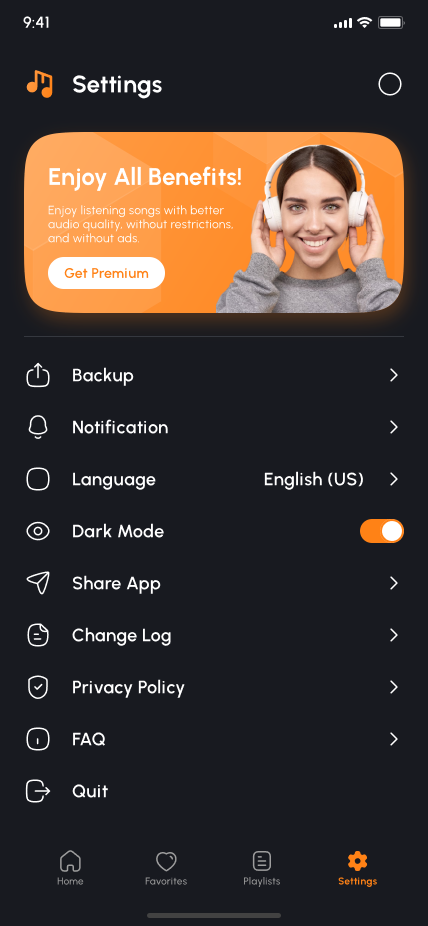

### 8.9 实机截图

以下图片均来自专用 AVD `mume_review`（`emulator-5556`，Android 15）中的实际导航与操作，
不是设计稿导出图。完整文件位于 `docs/screenshots/app/`：41 张 Light 页面一一对应设计稿编号，
另有 4 张 `*b_*` 命名的 Dark 首页、播放器、歌词与设置截图。

| 首页歌曲库 | 播放器 | 歌词与传输控制 |
| --- | --- | --- |
| 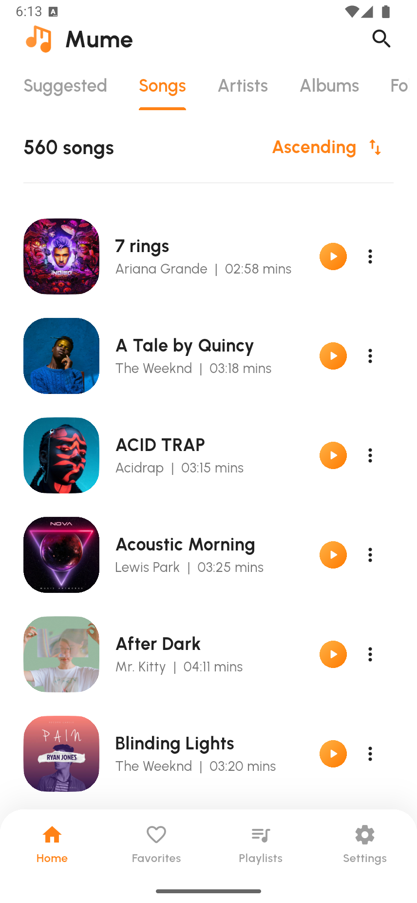 | 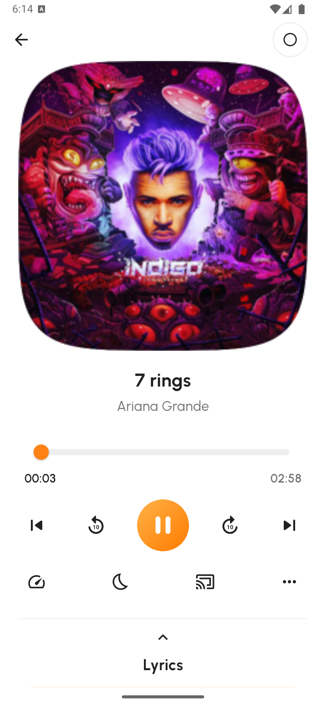 | 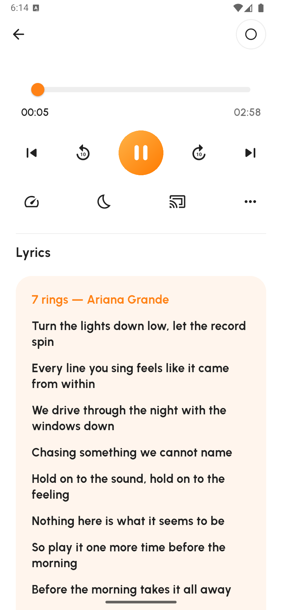 |

| 歌单管理 | Premium 订单确认 | Dark 设置 |
| --- | --- | --- |
| 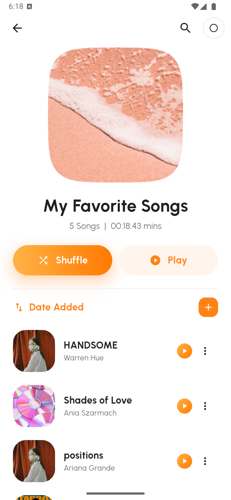 | 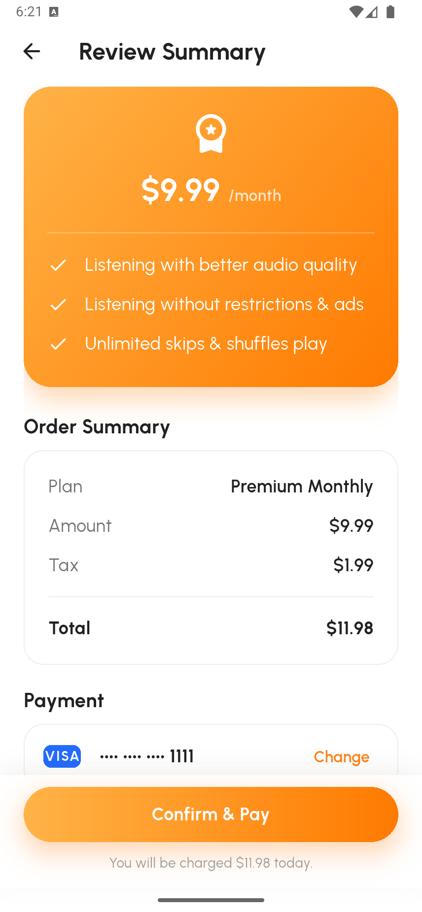 | 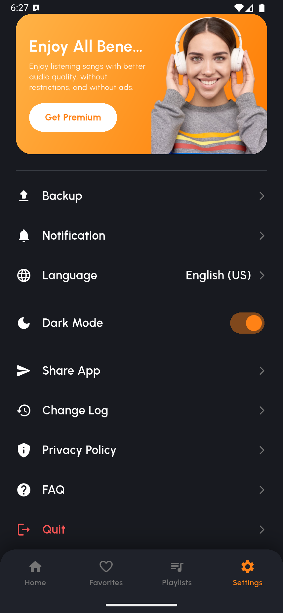 |

---

## 9. 设计稿覆盖对照

41 屏全部实现，Light 与 Dark 共用同一批代码。完整清单：

| # | 界面 | # | 界面 | # | 界面 |
| --- | --- | --- | --- | --- | --- |
| 01 | 启动页 | 15 | 首页-专辑 | 29 | 加入歌单 |
| 02–04 | 引导页 1–3 | 16 | 专辑详情 | 30 | 设置 |
| 05 | 首页-Suggested | 17 | 首页-文件夹 | 31 | 订阅 Premium |
| 06 | 首页-歌曲 | 18 | 文件夹详情 | 32 | 选择支付方式 |
| 07 | 排序面板 | 19 | 最近播放 | 33 | 添加银行卡 |
| 08 | 歌曲操作面板 | 20 | 搜索-输入 | 34 | 支付方式-已选 |
| 09 | 播放页 | 21 | 搜索-无结果 | 35 | 订单确认 |
| 10 | 播放-歌词 | 22 | 搜索-结果 | 36 | 订阅成功 |
| 11 | 首页+迷你播放器 | 23 | 收藏 | 37 | 通知设置 |
| 12 | 首页-艺人 | 24 | 收藏-操作面板 | 38 | 语言 |
| 13 | 艺人-操作面板 | 25 | 歌单 | 39 | 分享应用 |
| 14 | 艺人详情 | 26 | 新建歌单 | 40 | FAQ |
| 27 | 歌单详情 | 28 | 歌单-操作面板 | 41 | 退出确认 |

设计稿截图：`docs/screenshots/light/`、`docs/screenshots/dark/`（各 41 张，428×926）。
实机截图：`docs/screenshots/app/`（41 张 Light + 4 张 Dark，856×1852，为设计画板的 2 倍像素）。

---

## 10. 运行与验证

```bash
flutter pub get
flutter analyze

flutter run -d emulator-5556     # 或任意 Android/iOS 设备
flutter build apk --release --target-platform android-x64
```

本机验证结果：`flutter analyze` 为 0 issues；`library_test.dart` 与 `widget_test.dart`
共 7 项数据层和 Widget 测试通过。`route_render_test.dart` 定义了 26 个路由 × 2 种主题 ×
2 种视口的 104 项渲染检查；当前 Windows Flutter 3.47.7 的 `flutter_tester` 在连续重建页面时
会以原生 `0xC0000005` 退出并显示 `did not complete`，这不是 Dart 断言失败。实机已逐项跑通并截图。

实机验收路径：启动 → 引导 → 首页五个 Tab → 点歌进播放页 → 展开歌词 →
歌曲 / 艺人 / 专辑 / 文件夹操作面板 → 收藏 / 歌单增删 → 搜索 → 设置切深色 →
Premium 银行卡下单五步 → 通知 / 语言 / 分享 / FAQ → 退出确认。

---

## 11. 已知边界

1. **无音频输出**：播放为计时器模拟，见 §5.4。
2. **无持久化**：收藏、歌单、设置仅存内存，冷启动回到种子数据。
3. **无真实网络**：搜索、订阅、分享均为本地假数据；分享面板用 Material 图标近似品牌图标
   （设计稿用的是 WhatsApp / Twitter / Instagram 品牌图形，Flutter 内置图标集不含商标）。
4. **平台**：只配置了 Android 与 iOS；`SystemNavigator.pop()` 在 Android 上真能退出，
   iOS 上为约定行为。
5. 设计稿中的系统状态栏、iOS 键盘与部分插画细节按 Material 近似还原，未逐像素比对。
